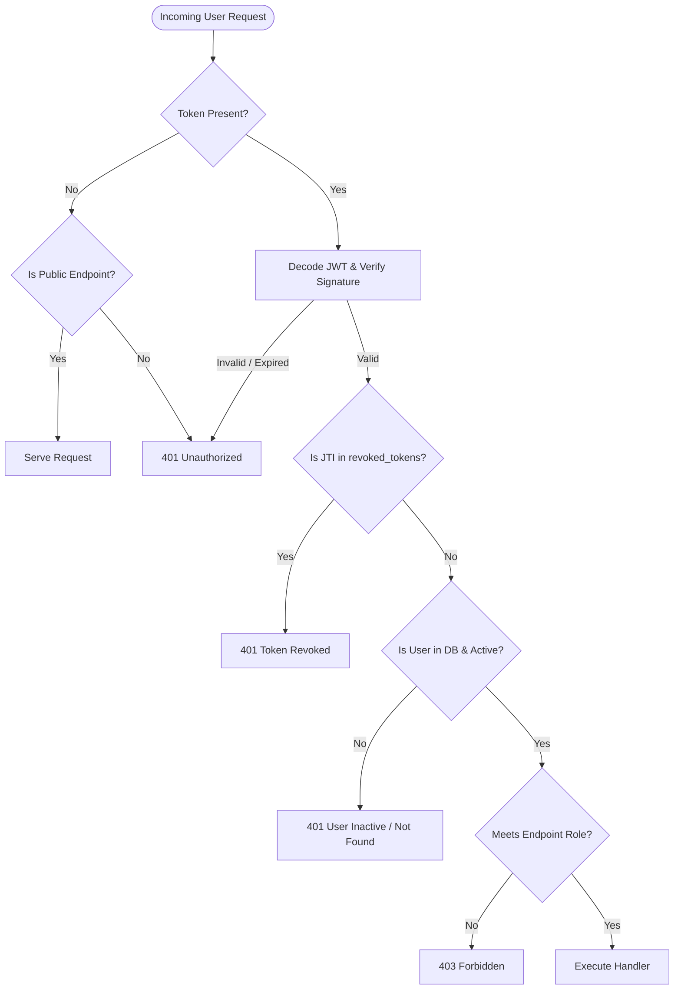

# Campus Byte – Campus Food Ordering & Delivery Management Platform

Campus Byte is a modern, enterprise-grade, full-stack campus food ordering and delivery management platform. It streamlines dining logistics, kitchen management, and peer-to-peer campus deliveries across three primary stakeholders:

1. **Customers (Students & Faculty):** Browse campus dining spots and restaurants, manage food carts, place orders to dorms and academic buildings, and track order lifecycles in real time.
2. **Restaurant Owners:** Manage restaurant profiles, menu catalogs, pricing, availability toggles, and track kitchen orders.
3. **Delivery Partners (Student Couriers):** Flexible on-campus peer delivery fleet operating between lectures with vehicle profiles and delivery status management.

---

## 1. Project Implementation Status

| Milestone | Scope | Status | Verification |
|---|---|---|---|
| **Phase 1** | Project Foundation & Workspace Environment | **Completed** | Full React 18 (Vite) + FastAPI scaffolding, Docker Compose, SCSS tokens |
| **Phase 2** | Database Architecture & Backend Foundation | **Completed** | PostgreSQL 17 + SQLAlchemy 2.0 + Alembic, 9 relational entities, 26 tests passing |
| **Phase 3** | Authentication, JWT Security, & RBAC | **Completed** | Argon2id hashing, dual-transport JWT, token denylist, role guards, 46 tests passing |
| **Phase 4** | Complete Restaurant & Menu Management | **Completed** | Owner dashboard, menu catalog, public discovery, IDOR protection, 54 tests passing |
| **Phase 5** | Customer Ordering, Cart & Campus Delivery Logistics | *Scheduled* | Cart management, order placement, courier dispatch, and live tracking |

---

## 2. Technology Stack

### Frontend
- **Framework:** React 18
- **Build Tool:** Vite
- **Language:** JavaScript (ES6+ / JSX)
- **Routing:** React Router DOM (v6) with declarative role guards (`ProtectedRoute`)
- **Styling:** Modular SCSS design system (CSS variables, BEM naming, responsive layouts)
- **HTTP Client:** Axios with centralized base configuration and credentials transport
- **Icons:** Lucide React
- **State Management:** React Context API (`AuthContext`)

### Backend
- **Framework:** Python FastAPI
- **ASGI Server:** Uvicorn
- **Database ORM:** SQLAlchemy 2.0 (Declarative Base, UUID primary keys, relationship cascades)
- **Database Driver:** `psycopg` (v3 with binary wheels)
- **Data Validation & Settings:** Pydantic v2 & Pydantic-Settings
- **Security & Password Hashing:** Argon2id (`argon2-cffi`) with PBKDF2 backward compatibility
- **Token Authorization:** PyJWT (HS256) with JTI denylisting
- **Database Migrations:** Alembic
- **Testing Suite:** Pytest + HTTPX + SQLAlchemy SQLite in-memory runner (46 automated tests)

### Database & Infrastructure
- **Relational Database:** PostgreSQL 17 (installed locally on port `5432`)
- **Containers:** Docker & Docker Compose
- **Version Control:** Git & GitHub (`https://github.com/chiru018/Campus_Byte`)

---

## 3. Project Architecture & Directory Structure

```
Campus_Byte/
├── backend/
│   ├── alembic/
│   │   ├── versions/
│   │   │   ├── 20261111_0001_initial_schema.py             # Phase 2: 9 core relational tables
│   │   │   └── 20261111_0002_add_revoked_tokens_table.py    # Phase 3: Token denylist table
│   │   └── env.py
│   ├── app/
│   │   ├── api/
│   │   │   └── routers/
│   │   │       ├── auth.py                                 # Auth endpoints (Register, Login, Me, Logout)
│   │   │       ├── protected_routes.py                     # RBAC demonstration test endpoints
│   │   │       ├── users.py                                # User CRUD & profile queries
│   │   │       ├── restaurants.py                          # Restaurant CRUD & availability patch
│   │   │       ├── menu.py                                 # Menu item CRUD & category filtering
│   │   │       └── dashboards.py                           # Aggregate metrics & KPIs
│   │   ├── core/
│   │   │   ├── config.py                                   # Pydantic BaseSettings environment manager
│   │   │   ├── security.py                                 # Argon2id hashing & JWT generation/decoding
│   │   │   ├── dependencies.py                             # Auth dependency injection (extract_raw_token, get_current_user)
│   │   │   ├── permissions.py                              # RBAC RoleChecker dependencies
│   │   │   └── exceptions.py                               # Custom typed HTTP exceptions
│   │   ├── crud/
│   │   │   ├── crud_user.py                                # User persistence logic
│   │   │   ├── crud_restaurant.py                          # Restaurant persistence logic
│   │   │   ├── crud_menu.py                                # Menu item persistence logic
│   │   │   ├── crud_delivery.py                            # Delivery partner profile CRUD
│   │   │   └── crud_token.py                               # Token revocation & denylist queries
│   │   ├── db/
│   │   │   ├── base.py                                     # Base declarative model definition
│   │   │   └── session.py                                  # Engine creation & sessionmaker dependency
│   │   ├── models/
│   │   │   ├── user.py                                     # User entity (roles, active flag)
│   │   │   ├── restaurant.py                               # Restaurant entity (owner relationship)
│   │   │   ├── menu_item.py                                # Menu items (pricing, availability)
│   │   │   ├── order.py                                    # Order headers & status lifecycles
│   │   │   ├── order_item.py                               # Order line items & snapshot prices
│   │   │   ├── delivery.py                                 # Delivery assignments & statuses
│   │   │   ├── delivery_partner.py                         # Delivery partner vehicle & profile
│   │   │   ├── address.py                                  # Campus delivery addresses
│   │   │   ├── payment.py                                  # Transaction records
│   │   │   └── revoked_token.py                            # Revoked JWT denylist table
│   │   ├── schemas/
│   │   │   ├── auth.py                                     # Auth requests, responses, & password validators
│   │   │   ├── user.py                                     # User request/response schemas
│   │   │   ├── restaurant.py                               # Restaurant request/response schemas
│   │   │   ├── menu.py                                     # Menu item schemas
│   │   │   └── dashboard.py                                # System KPI aggregate schemas
│   │   ├── services/
│   │   │   └── auth_service.py                             # Atomic user + profile registration & login
│   │   └── main.py                                         # FastAPI app instance, CORS & router registry
│   ├── tests/
│   │   ├── conftest.py                                     # Pytest fixtures & isolated SQLite DB engine
│   │   ├── test_auth_and_rbac.py                           # 20 automated auth, JWT, & RBAC tests
│   │   ├── test_database.py                                # 5 schema & constraint verification tests
│   │   ├── test_users.py                                   # 5 user management tests
│   │   ├── test_restaurants.py                             # 9 restaurant lifecycle tests
│   │   ├── test_menu.py                                    # 6 menu management tests
│   │   └── test_dashboards.py                              # 1 dashboard KPI test
│   ├── requirements.txt
│   ├── alembic.ini
│   └── Dockerfile
├── frontend/
│   ├── src/
│   │   ├── components/
│   │   │   ├── common/                                     # Button, Card, Badge, Input UI primitives
│   │   │   ├── navigation/                                 # Navbar with role-based links & Sign Out
│   │   │   └── layout/                                     # AppLayout shell & Footer
│   │   ├── context/
│   │   │   └── AuthContext.jsx                             # Global auth state, session check, login, logout
│   │   ├── pages/
│   │   │   ├── public/
│   │   │   │   ├── LandingPage.jsx                         # Landing page with role sign-up entrypoints
│   │   │   │   ├── LoginPage.jsx                           # Unified email/password login
│   │   │   │   ├── CustomerRegisterPage.jsx                # Customer registration view
│   │   │   │   ├── RestaurantOwnerRegisterPage.jsx         # Restaurant owner registration view
│   │   │   │   ├── DeliveryPartnerRegisterPage.jsx         # Courier partner registration view
│   │   │   │   ├── UnauthorizedPage.jsx                    # 403 Forbidden feedback view
│   │   │   │   └── Auth.scss                               # Modern glassmorphism authentication styling
│   │   │   ├── customer/
│   │   │   │   └── CustomerDashboard.jsx                   # Customer orders & marketplace hub
│   │   │   ├── restaurant/
│   │   │   │   └── RestaurantDashboard.jsx                 # Restaurant owner portal & menu overview
│   │   │   └── delivery/
│   │   │       └── DeliveryDashboard.jsx                   # Delivery courier shift & active task hub
│   │   ├── routes/
│   │   │   ├── AppRoutes.jsx                               # Declarative React Router DOM tree
│   │   │   └── ProtectedRoute.jsx                          # Role-based route guard
│   │   ├── services/
│   │   │   └── api.js                                      # Axios instance with auth interceptors & authApi
│   │   └── styles/
│   │       ├── variables.scss                              # Color palettes, elevation, spacing
│   │       └── global.scss                                 # Resets and atomic classes
│   ├── package.json
│   └── vite.config.js
├── docs/                                                   # Comprehensive engineering documentation
│   ├── architecture.md                                     # System architecture & boundary definitions
│   ├── api-documentation.md                                # OpenAPI endpoint catalog with sample payloads
│   ├── security-checklist.md                               # OWASP Top 10 mitigation verification
│   ├── testing-strategy.md                                 # Backend & frontend quality assurance plan
│   ├── deployment-guide.md                                 # Production deployment & environment setup
│   ├── technical-decisions.md                              # Architecture Decision Records (ADRs)
│   ├── database-erd.md                                     # Mermaid ER diagram & relational mappings
│   └── database-schema.md                                  # Schema specifications, indexes, & constraints
├── docker-compose.yml
└── README.md
```

---

## 4. Authentication, Security & RBAC Architecture

Campus Byte enforces strict Role-Based Access Control (RBAC) across three non-overlapping user roles:



### Core Security Highlights

1. **Role Spoofing Prevention:**
   - Public registration does **not** accept a `role` field from client payloads.
   - Separate, dedicated endpoints bind roles server-side:
     - `POST /api/auth/register/customer` $\rightarrow$ forces `UserRole.CUSTOMER`
     - `POST /api/auth/register/restaurant-owner` $\rightarrow$ forces `UserRole.RESTAURANT_OWNER` and creates the `Restaurant` entity atomically.
     - `POST /api/auth/register/delivery-partner` $\rightarrow$ forces `UserRole.DELIVERY_PARTNER` and creates the `DeliveryPartner` profile atomically.
2. **Password Security (Argon2id):**
   - Hashed using `argon2-cffi` with salt and memory-hard configuration.
   - Enforces strict password complexity: $\ge 8$ characters, uppercase letter, lowercase letter, number, and special character.
3. **Dual Token Transport:**
   - Returns bearer token in JSON response payload (`access_token`).
   - Automatically sets secure `HttpOnly`, `SameSite=Lax` cookie (`campus_byte_access_token`).
4. **Server-Side Token Revocation:**
   - Every issued access token contains a cryptographically random UUID `jti` (JWT ID).
   - Upon calling `POST /api/auth/logout`, the `jti` is inserted into the PostgreSQL `revoked_tokens` table.
   - Revoked tokens are immediately rejected across all protected endpoints.
5. **Access Control Matrix:**

| Role | Customer Views | Restaurant Management | Delivery Dispatch | Public Menu Browsing |
|---|:---:|:---:|:---:|:---:|
| **CUSTOMER** | :white_check_mark: Allowed | :x: 403 Forbidden | :x: 403 Forbidden | :white_check_mark: Allowed |
| **RESTAURANT_OWNER** | :x: 403 Forbidden | :white_check_mark: Allowed | :x: 403 Forbidden | :white_check_mark: Allowed |
| **DELIVERY_PARTNER** | :x: 403 Forbidden | :x: 403 Forbidden | :white_check_mark: Allowed | :white_check_mark: Allowed |
| **GUEST (Unauthenticated)** | :x: 401 Unauthorized | :x: 401 Unauthorized | :x: 401 Unauthorized | :white_check_mark: Allowed |

---

## 5. API Endpoints Catalog

### Authentication & RBAC (`/api/auth`)
| Method | Endpoint | Description | Auth Required |
|---|---|---|---|
| `POST` | `/api/auth/register/customer` | Registers a student or faculty customer | Public |
| `POST` | `/api/auth/register/restaurant-owner` | Registers owner and provisions Restaurant entity | Public |
| `POST` | `/api/auth/register/delivery-partner` | Registers courier and provisions DeliveryPartner profile | Public |
| `POST` | `/api/auth/login` | Authenticates credentials and returns JWT + HttpOnly cookie | Public |
| `GET` | `/api/auth/me` | Fetches authenticated user profile and active role | Bearer / Cookie |
| `POST` | `/api/auth/logout` | Denylists token `jti` in PostgreSQL and clears cookies | Bearer / Cookie |

### RBAC Demonstration Endpoints (`/api/protected`)
| Method | Endpoint | Required Role | Description |
|---|---|---|---|
| `GET` | `/api/protected/customer-only` | `CUSTOMER` | Confirms customer authorization |
| `GET` | `/api/protected/restaurant-owner-only` | `RESTAURANT_OWNER` | Confirms owner authorization |
| `GET` | `/api/protected/delivery-partner-only` | `DELIVERY_PARTNER` | Confirms delivery partner authorization |

### Restaurant & Menu Management
| Method | Endpoint | Description |
|---|---|---|
| `GET` | `/api/restaurants/` | Paginated restaurant search with filters |
| `POST` | `/api/restaurants/` | Create a new restaurant profile |
| `GET` | `/api/restaurants/{id}` | Retrieve restaurant details and menus |
| `PUT` | `/api/restaurants/{id}` | Update restaurant configuration |
| `PATCH` | `/api/restaurants/{id}/availability` | Toggle open/closed status |
| `DELETE` | `/api/restaurants/{id}` | Soft/hard delete restaurant |
| `GET` | `/api/menu/restaurant/{id}` | Get menu items for a restaurant |
| `POST` | `/api/menu/` | Add menu item with category & price |
| `GET` | `/api/menu/{id}` | Get menu item details |
| `PUT` | `/api/menu/{id}` | Update menu item details |
| `DELETE` | `/api/menu/{id}` | Remove menu item |

---

## 6. Engineering Documentation Index

The `docs/` folder contains comprehensive engineering specifications:

- [Engineering Standards](docs/ENGINEERING_STANDARDS.md): Mandatory architectural, security, testing, and database guidelines.
- [System Architecture Document](docs/architecture.md): Service boundaries, data flow diagrams, and architectural patterns.
- [API Documentation](docs/api-documentation.md): Detailed OpenAPI endpoint catalog, payload contracts, and error responses.
- [Security Checklist](docs/security-checklist.md): Comprehensive OWASP Top 10 compliance audit.
- [Testing Strategy](docs/testing-strategy.md): Automated backend & frontend test suites, coverage goals, and CI execution.
- [Deployment Guide](docs/deployment-guide.md): Production hardening, containerization, environment variables, and migration runbooks.
- [Technical Decisions (ADRs)](docs/technical-decisions.md): Architecture Decision Records documenting key engineering trade-offs.
- [Database ER Diagram](docs/database-erd.md): Mermaid relational entity diagram including the `revoked_tokens` table.
- [Database Schema Specification](docs/database-schema.md): Full schema dictionary, primary keys, check constraints, and foreign keys.

---

## 7. Local Development Setup Guide

### Prerequisites
- Python 3.12+ (or 3.14)
- Node.js 18+ & npm
- PostgreSQL 17 (running locally on port 5432)

### 1. Database Setup
Ensure PostgreSQL is running and initialize the database:
```powershell
& "C:\Program Files\PostgreSQL\17\bin\psql.exe" -U postgres -c "CREATE DATABASE campus_byte;"
```

Run database migrations using Alembic:
```powershell
cd backend
..\.venv\Scripts\alembic.exe upgrade head
cd ..
```

### 2. Backend Setup
Activate the Python virtual environment and run the backend server:
```powershell
# Windows PowerShell
.\.venv\Scripts\Activate.ps1

# Install requirements (if not already installed)
pip install -r backend/requirements.txt

# Run FastAPI development server
cd backend
uvicorn app.main:app --reload --host 127.0.0.1 --port 8000
```
API endpoints will be accessible at:
- **Root:** `http://localhost:8000/`
- **Health Check:** `http://localhost:8000/health`
- **Interactive Swagger Docs:** `http://localhost:8000/docs`
- **ReDoc Documentation:** `http://localhost:8000/redoc`

### 3. Frontend Setup
Start the Vite development server:
```powershell
cd frontend
npm install
npm run dev
```
Frontend will be accessible at:
- **Web App:** `http://localhost:5173`
- **Login:** `http://localhost:5173/login`
- **Customer Registration:** `http://localhost:5173/register/customer`
- **Restaurant Registration:** `http://localhost:5173/register/restaurant-owner`
- **Delivery Registration:** `http://localhost:5173/register/delivery-partner`

---

## 8. Automated Testing & Verification

Run the comprehensive automated backend test suite (54 tests):
```powershell
.\.venv\Scripts\pytest.exe backend/tests -v
```

All 54 test cases cover:
- Customer, Restaurant Owner, and Delivery Partner registration.
- Duplicate email prevention and invalid email formatting rejection.
- Password policy verification (mismatch, weak length, missing requirements).
- Unified login with Argon2id hash verification and constant-time failure response.
- Inactive user rejection.
- JWT decoding, expiration enforcement, invalid signature rejection, and malformed header detection.
- Logout and server-side token revocation checking against PostgreSQL `revoked_tokens`.
- Cross-role authorization tests (403 Forbidden verification).
- Restaurant creation by authenticated owner, rejection by customers, and prevention of duplicate restaurants per owner.
- IDOR ownership security tests (rejecting modification of another owner's restaurant or menu items).
- Menu item management (creation, update, availability toggling, price > 0 validation).
- Standard food category validation and filtering.
- Safe historical record deactivation preserving referential integrity for orders.
- Schema integrity, positive price constraints, and database relationships.

To verify frontend compilation:
```powershell
npm --prefix frontend run build
```
Builds 1680+ modules cleanly to `frontend/dist/` with zero errors.

---

## 9. Git Repository & Remote Sync

The repository is hosted on GitHub at [https://github.com/chiru018/Campus_Byte](https://github.com/chiru018/Campus_Byte).

To check repository status or pull the latest changes:
```powershell
git status
git pull origin main
```
