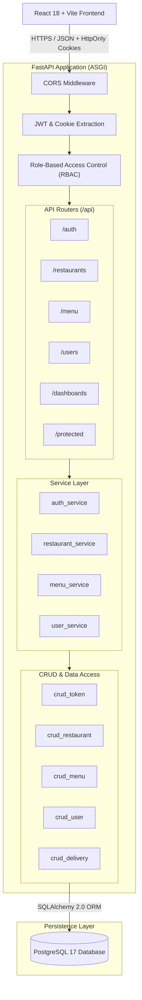

# Campus Byte – System Architecture Documentation

Campus Byte is engineered as a decoupled, multi-stakeholder campus food ordering and delivery management system.

---

## 1. High-Level Architecture Overview

---

## 2. Multi-Stakeholder Roles & Permission Matrix

The platform strictly differentiates three participant types:

| Role | Permitted Actions & Boundaries | Prohibited Actions |
| :--- | :--- | :--- |
| **`CUSTOMER`** | Register, login, view public restaurants/menus, view and place own orders, access `/customer/dashboard`. | Cannot create restaurants, manage menus, accept deliveries, or view other customers' orders. |
| **`RESTAURANT_OWNER`** | Register with automatic restaurant provisioning, manage own restaurant profile & menu, view kitchen orders, access `/restaurant/dashboard`. | Cannot place delivery runs, mark orders delivered, or access other restaurants' analytics. |
| **`DELIVERY_PARTNER`** | Register with vehicle mode, toggle on-duty availability, view and accept eligible campus drops, access `/delivery/dashboard`. | Cannot alter restaurant items, modify menu prices, or access customer billing records. |

---

## 3. Authentication & Security Design

1. **Password Security:**
   - Hashing: `Argon2id` (via `argon2-cffi`), memory-hard, highly resistant to GPU cracking.
   - Policy: Minimum 8 characters, at least 1 uppercase, 1 lowercase, 1 number, and 1 special symbol.
   - Plaintext passwords and hashes are never exposed in logs or API responses.
2. **Stateless JWT with Server-Side Revocation:**
   - Tokens signed with HMAC-SHA256 (`HS256`) using environment secret `JWT_SECRET_KEY`.
   - Claims: `sub` (User UUID), `role` (Role string), `iat`, `exp` (30 min lifetime), `jti` (Token UUID).
   - Revocation: When a user logs out, the token's `jti` is stored in the `revoked_tokens` table. On every request, `get_current_user` verifies the token has not been revoked.
3. **Transport Security:**
   - Dual-mode support: Authorization Bearer header + secure HttpOnly cookies (`SameSite=Lax`, `HttpOnly=True`).
4. **Backend-Enforced RBAC:**
   - Reusable `RoleChecker` dependency enforces required roles at the FastAPI routing layer.

---

## 4. Frontend Architecture

1. **State Management:**
   - `AuthContext`: Centralized provider tracking `user`, `role`, `loading`, `isAuthenticated`.
   - On app load: Restores session by calling `GET /api/auth/me`.
2. **Routing & Guards:**
   - `ProtectedRoute`: Evaluates role membership; redirects unauthenticated visitors to `/login` with target path preserved, and unauthorized roles to `/unauthorized`.
3. **Decoupled API Client:**
   - Axios instance with interceptors attaching Bearer tokens and managing 401 unauthenticated purges.
