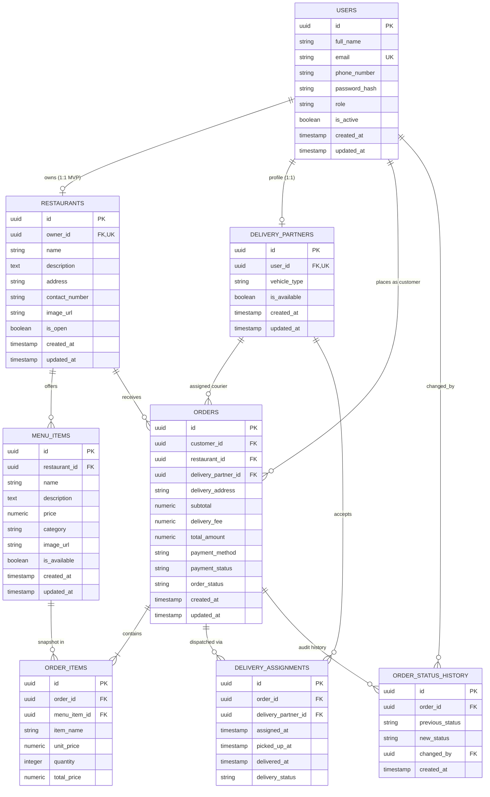

# Campus Byte – Database Entity Relationship Diagram (ERD)

This document visualizes the complete normalized relational database schema for Campus Byte (Phase 2).

---

## Key Cardinalities & Constraints Summary

1. **User to Restaurant (1:1 MVP):**
   - Each restaurant is owned by one `RESTAURANT_OWNER` user.
   - Enforced by unique constraint `owner_id UNIQUE` on `restaurants`.
2. **User to Delivery Partner (1:1):**
   - Each courier profile belongs to one `DELIVERY_PARTNER` user.
   - Enforced by unique constraint `user_id UNIQUE` on `delivery_partners`.
3. **Restaurant to Menu Items (1:N):**
   - Cascading deletion: deleting a restaurant safely cleans up draft menu items if no orders exist.
4. **Order to Order Items (1:N):**
   - Strong composition. `order_items` stores historical snapshots of `item_name` and `unit_price`.
5. **Check Constraints:**
   - `menu_items.price > 0`
   - `order_items.quantity > 0`
   - `order_items.unit_price > 0`
   - `order_items.total_price > 0`
   - `orders.subtotal >= 0`, `orders.delivery_fee >= 0`, `orders.total_amount >= 0`
